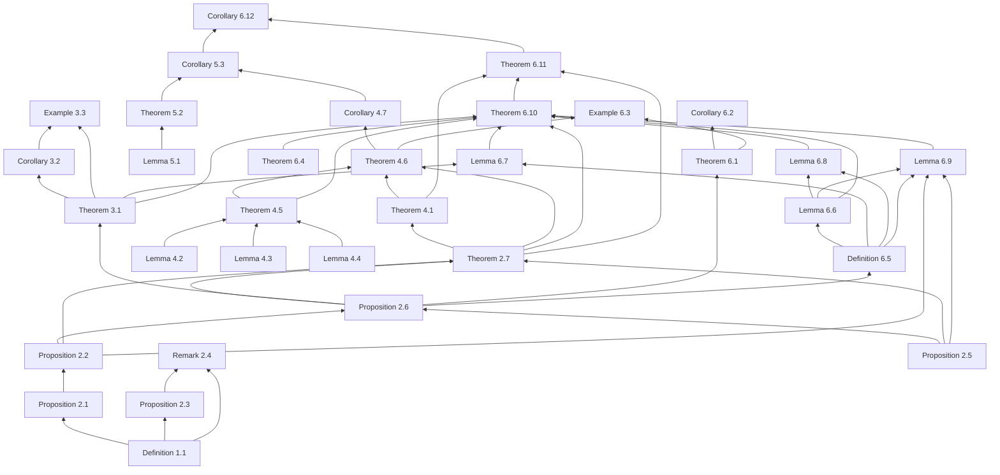

# Dependency graph of the paper

Generated from `main.tex` (explicit `\ref`/`\cite` plus implicit uses noted by hand). Numbering as in the compiled paper.

Forward references: none

| Statement | Depends on (internal) | External sources | Notes |
|---|---|---|---|
| Definition 1.1 (`DefTopProj`) | — | NemMetrTopHomol | conventions of the book |
| Proposition 2.1 (`EquivWithHelemskii`) | Definition 1.1 | HelExtrProjSeqAlg (def. I) | renorming argument; self-contained |
| Proposition 2.2 (`FreeIsExtrProj`) | Proposition 2.1 | HelExtrProjSeqAlg (prop. 2.2) | proof = citation + 2.1 |
| Proposition 2.3 (`NoOneTopProj`) | Definition 1.1 | — | Hahn--Banach; self-contained |
| Remark 2.4 (`RemarkStrictConvention`) | Proposition 2.3, Definition 1.1 | HelMetrFrQMod; NemMetrTopHomol (prop. 2.1.9) | remark, not used later |
| Proposition 2.5 (`RetractOfProj`) | — | WhiteInjmoduAlg (lemma 2.7); NemMetrTopHomol (prop. 2.1.3); HelExtrProjSeqAlg (prop. 1.1) | proof omitted (standard) |
| Proposition 2.6 (`CanonicalMorphismCriterion`) | Proposition 2.2, Proposition 2.5 | — | uses the operator pi_P defined in the text before it |
| Theorem 2.7 (`ExtrProjCriterion`) | Proposition 2.6, Proposition 2.2, Proposition 2.5 | HelExtrProjSeqAlg (sec. 2, near-retracts) | (i)<=>(iii) is Helemskii |
| Theorem 3.1 (`SeparableSubspaces`) | Proposition 2.6 | HelExtrProjSeqAlg (prop. 2.4, separable case) |  |
| Corollary 3.2 (`NoCompleteSubspaces`) | Theorem 3.1 | HelExtrProjSeqAlg (prop. 2.5 for l_1(Lambda)); LowigDimLinRaume | uses Baire: infinite-dimensional Banach spaces have uncountable dimension |
| Example 3.3 (`WeightedExample`) | Theorem 3.1, Corollary 3.2 | — | open mapping theorem |
| Theorem 4.1 (`CompletionIsEllOne`) | Theorem 2.7 | HelExtrProjSeqAlg (prop. 2.3); GronLiftProbNormSp (sec. 3); GrothMetrProjFlatBanSp; HelMetrFrQMod (prop. 3.2); LaceyIsomThOfClassicBanSp (thm. 3.11.6, sec. 17) | cited theorem; proof only sketched |
| Lemma 4.2 (`OneVectorTheorem`) | — | — | Neumann series; self-contained |
| Lemma 4.3 (`HittingLemma`) | — | — | Hahn--Banach, Neumann series |
| Lemma 4.4 (`ProductLemma`) | — | — | self-contained |
| Theorem 4.5 (`BackAndForth`) | Lemma 4.2, Lemma 4.3, Lemma 4.4 | — |  |
| Theorem 4.6 (`MainTheorem`) | Theorem 4.1, Theorem 4.5, Theorem 2.7 | — |  |
| Corollary 4.7 (`DenseCountableSubspaces`) | Theorem 4.6 | — | no proof given (immediate) |
| Lemma 5.1 (`ExtremePointsLemma`) | — | — | self-contained |
| Theorem 5.2 (`NotIsometricToFree`) | Lemma 5.1 | — |  |
| Corollary 5.3 (`CounterexampleCorollary`) | Corollary 4.7, Theorem 5.2 | HelExtrProjSeqAlg (sec. 2, question); HelMetrFrQMod (sec. 1); GronLiftProbNormSp (conj. 3.1) | text after it states what it answers |
| Theorem 6.1 (`FodorObstruction`) | Proposition 2.6 | JechSetTheory (thm. 8.7, Fodor) |  |
| Corollary 6.2 (`OmegaOneContinuity`) | Theorem 6.1 | — |  |
| Example 6.3 (`LadderSpace`) | Theorem 4.6, Theorem 6.1 | — | (ii) uses 4.6, (iii) uses 6.1 |
| Theorem 6.4 (`TransfiniteBackAndForth`) | — | — | self-contained; remark after it uses 4.5 and 6.3 |
| Definition 6.5 (`ClosedPair`) | Proposition 2.6 | — | standing data sigma, pi, p_n^gamma fixed before it |
| Lemma 6.6 (`ClosedPairProps`) | Definition 6.5 | — |  |
| Lemma 6.7 (`ClosingOff`) | Definition 6.5, Theorem 3.1 | — | density claim uses (c) of the definition |
| Lemma 6.8 (`UnionsOfClosedPairs`) | Definition 6.5, Lemma 6.6 | — |  |
| Lemma 6.9 (`BlockRetract`) | Definition 6.5, Lemma 6.6, Proposition 2.5, Proposition 2.2 | — | retract of a free space is projective: 2.3 + 2.5 |
| Theorem 6.10 (`GeneralTheorem`) | Theorem 3.1, Theorem 4.5, Theorem 6.4, Lemma 6.6, Lemma 6.7, Lemma 6.8, Lemma 6.9, Theorem 2.7 | — | induction on |Gamma|; uses itself for smaller cardinals |
| Theorem 6.11 (`FinalCharacterization`) | Theorem 4.1, Theorem 6.10, Theorem 2.7 | — |  |
| Corollary 6.12 (`GronbaekConjecture`) | Theorem 6.11, Corollary 5.3 | GronLiftProbNormSp (conj. 3.1) | no proof given (immediate) |

## Used by

- Definition 1.1: Proposition 2.1, Proposition 2.3, Remark 2.4
- Proposition 2.1: Proposition 2.2
- Proposition 2.2: Proposition 2.6, Theorem 2.7, Lemma 6.9
- Proposition 2.3: Remark 2.4
- Remark 2.4: not used later
- Proposition 2.5: Proposition 2.6, Theorem 2.7, Lemma 6.9
- Proposition 2.6: Theorem 2.7, Theorem 3.1, Theorem 6.1, Definition 6.5
- Theorem 2.7: Theorem 4.1, Theorem 4.6, Theorem 6.10, Theorem 6.11
- Theorem 3.1: Corollary 3.2, Example 3.3, Lemma 6.7, Theorem 6.10
- Corollary 3.2: Example 3.3
- Example 3.3: not used later
- Theorem 4.1: Theorem 4.6, Theorem 6.11
- Lemma 4.2: Theorem 4.5
- Lemma 4.3: Theorem 4.5
- Lemma 4.4: Theorem 4.5
- Theorem 4.5: Theorem 4.6, Theorem 6.10
- Theorem 4.6: Corollary 4.7, Example 6.3
- Corollary 4.7: Corollary 5.3
- Lemma 5.1: Theorem 5.2
- Theorem 5.2: Corollary 5.3
- Corollary 5.3: Corollary 6.12
- Theorem 6.1: Corollary 6.2, Example 6.3
- Corollary 6.2: not used later
- Example 6.3: not used later
- Theorem 6.4: Theorem 6.10
- Definition 6.5: Lemma 6.6, Lemma 6.7, Lemma 6.8, Lemma 6.9
- Lemma 6.6: Lemma 6.8, Lemma 6.9, Theorem 6.10
- Lemma 6.7: Theorem 6.10
- Lemma 6.8: Theorem 6.10
- Lemma 6.9: Theorem 6.10
- Theorem 6.10: Theorem 6.11
- Theorem 6.11: Corollary 6.12
- Corollary 6.12: not used later

## Diagram (Mermaid)

